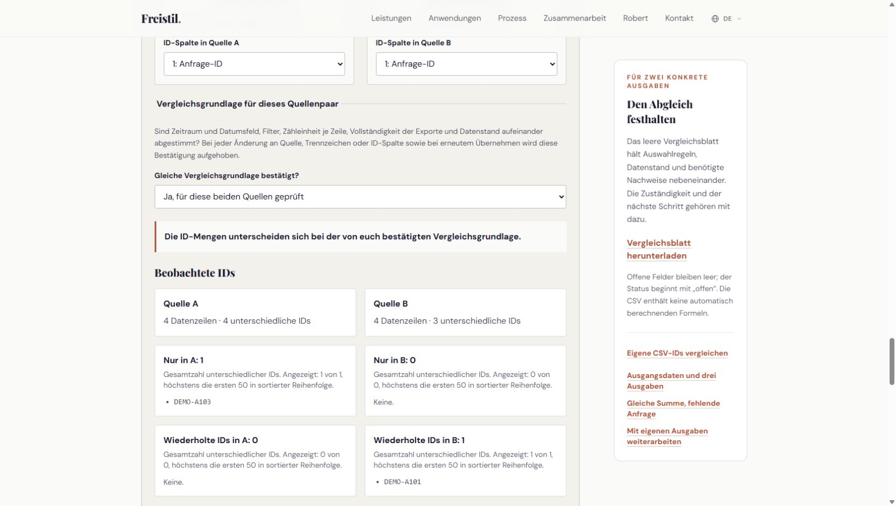

# Zwei CSV-Ausgaben über IDs vergleichen

Der [CSV-ID-Vergleich](https://www.freistil-consulting.de/de/ressourcen/berichte-abgleichen#csv-vergleich) zeigt fehlende und wiederholte IDs in zwei Ausgaben. Ihr braucht Exporte mit einer gemeinsamen, stabilen Kennung, etwa einer Anfrage-ID. Das Werkzeug ist ohne Anmeldung nutzbar.

1. Nutzt UTF-8-Exporte mit Kopfzeile. Wählt pro Quelle eine Datei oder fügt den Tabelleninhalt ein. Die Dateiauswahl füllt das Textfeld; übernehmt die Quelle anschließend.
2. Wählt je Quelle das Trennzeichen ausdrücklich: Semikolon, Komma oder Tabulator. Klickt auf „Quelle A übernehmen“ beziehungsweise „Quelle B übernehmen“ und wählt jeweils die ID-Spalte.
3. Die Grundlage beginnt bei „Noch ungeklärt“. Prüft Zeitraum und Datumsfeld, Filter, Zähleinheit je Zeile, Vollständigkeit und Datenstand beider Exporte. Bestätigt erst dann die gleiche Grundlage. Nach Änderungen an Quellen, Trennzeichen oder ID-Spalten sowie erneutem Übernehmen müsst ihr sie erneut bestätigen.
4. Lest Datenzeilen und unterschiedliche IDs getrennt. Prüft „Nur in A“, „Nur in B“ und wiederholte IDs. Wiederholungen können beabsichtigte Detailzeilen sein; klärt die Zähleinheit vor Änderungen.

„Synthetisches Beispiel laden“ zeigt je vier Datenzeilen: A enthält vier unterschiedliche IDs, B nur drei. In B fehlt `DEMO-A103`, `DEMO-A101` steht zweimal darin. Auch im Beispiel bleibt die Grundlage zunächst ungeklärt.

IDs werden exakt verglichen: Groß- und Kleinschreibung sowie Leerzeichen zählen mit. Leere oder nur aus Leerzeichen bestehende IDs sind ungültig. Je Quelle gelten 1 MiB UTF-8-Text, 2.000 Datenzeilen und 100 Spalten. Jede Ergebnisliste zeigt höchstens 50 IDs und die vollständige Anzahl.

Dateiinhalte und eingefügter Text werden nur im Browser verarbeitet, weder hochgeladen noch dauerhaft gespeichert. Der Abgleich prüft ausschließlich IDs, keine Beträge, sonstigen Feldwerte oder fachliche Berichtsrichtigkeit.

Bleiben Schlüssel oder Vergleichsregeln offen, [beschreibt Robert euren Prüffall](https://www.freistil-consulting.de/de#contact). CSV-Inhalte werden nicht in die Nachricht übernommen.
